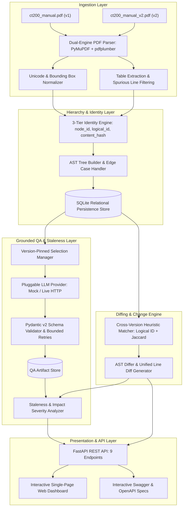

# Assignment Approach Document — Tri9T Manual Intelligence Platform

**Candidate Name**: Srivikasini Velavan  
**Project Repository**: [https://github.com/srivikasini/Tri9T-Manual-Intelligence](https://github.com/srivikasini/Tri9T-Manual-Intelligence)  
**Role Target**: AI Engineer / Document AI & Backend Specialist  
**Tech Stack**: Python 3.12+, FastAPI, PyMuPDF, pdfplumber, Pydantic v2, SQLAlchemy, Pytest, difflib, TailwindCSS  

---

## 1. Executive Summary & Problem Context

In safety-critical technical domains (such as medical devices, aerospace, and industrial machinery), operator and service manuals frequently undergo revisions. When a manual is updated from version 1 to version 2:
1. Existing verification suites and QA test procedures become **stale** or invalid.
2. Safety parameters shift silently (e.g., auto-deflation thresholds changing from 2.0s to 1.5s).
3. Naive text diffing fails due to irregular numbering, page reflows, and table formatting shifts.

The **Tri9T Manual Intelligence Platform** addresses this challenge by providing an end-to-end, automated document intelligence pipeline that:
* Ingests native PDF manuals with layout provenance and tabular structure extraction.
* Normalizes non-linear document hierarchies using a **3-tier node identity model**.
* Performs non-destructive cross-version AST diffing to detect content drift, additions, and removals.
* Synthesizes **strictly grounded QA test ideas** via an LLM pipeline with schema enforcement and bounded retries.
* Continuously evaluates existing test artifacts against new revisions to compute **staleness severity and impact remediation**.

---

## 2. High-Level System Architecture

The platform follows a layered, modular clean architecture where each subsystem has isolated responsibilities:

---

## 3. Key Engineering Approaches by Subsystem

### 3.1 Dual-Engine PDF Ingestion & Layout Parsing
* **Why PyMuPDF (fitz) + pdfplumber?**  
  Standard OCR or basic text dump tools destroy reading order and tables. We use:
  * **PyMuPDF**: Fast native C extraction of text spans, font size, font flags (boldness), and exact `(x0, y0, x1, y1)` bounding boxes to classify heading levels dynamically.
  * **pdfplumber**: Explicit extraction of tabular matrices (e.g., Section 2.1 Specifications table and Section 4.2 Error Codes table) without breaking cell alignments.
* **Layout Edge Cases Handled in the Source PDFs**:
  1. **Missing Intermediate Levels**: Section `2.1` jumps directly to `2.1.1.1` without a `2.1.1`. The tree builder attaches it to the nearest available ancestor and records an extraction warning.
  2. **Irregular / Out-of-Order Numbering**: Section `3.2` is followed by `3.4` before `3.3`. The extractor preserves physical document order and records a sequence warning.
  3. **Duplicate Headings Across Parents**: Section `4.2 Error Codes` (under Section 4) and Section `7.1 Error Codes` (under Section 7) share identical titles. They are scoped into distinct parent paths to eliminate collisions.
  4. **Multi-Page Continuations**: Sections spanning page breaks (`4.3`, `6.1`, `8.1`) have their text blocks merged without sentence truncation.

---

### 3.2 Three-Tier Node Identity & Version Matching
Document versions cannot be compared reliably using raw database primary keys or volatile section titles. We implemented a **three-tier identity strategy**:

1. **`node_id` (Physical Snapshot Key)**: E.g., `v1_sec_4_2_error-codes`. Unique per document version. Ensures v1 and v2 records coexist in the database without overwriting history.
2. **`logical_id` (Cross-Version Semantic Key)**: E.g., `sec:4.2:error-codes`. Hierarchically scoped (`sec:{num}:{slug}`) to remain stable across revisions.
3. **`content_hash` (Cryptographic Digest)**: SHA-256 computed over Unicode-normalized (NFKD) title, section number, body text, and canonical JSON table structure. Even a single character shift (e.g., `2.0s` to `1.5s`) changes this hash deterministically.

---

### 3.3 Cross-Version Diffing & Change Detection
The matching engine pairs nodes between v1 and v2 using a multi-factor heuristic:
1. Exact `logical_id` match.
2. Section number equivalence.
3. Token Jaccard similarity and Levenshtein string distance on titles.

Changes are classified into 5 distinct states:
* **`UNCHANGED`** (23 nodes): Logical IDs and SHA-256 hashes match identically.
* **`MODIFIED`** (4 nodes): Logical IDs match, but hashes drift. Synthesizes a unified line diff (e.g., Battery cycles `300 -> 250`, Inflation increment `40 -> 30 mmHg`, Error code `E6` added, Overpressure auto-deflation `2.0s -> 1.5s`).
* **`ADDED`** (1 node): Section `5.3 Data Export` introduced in v2.
* **`MOVED`** (0 nodes): Content unchanged but parent/number changed.
* **`REMOVED`** (0 nodes): Present in base, absent in target.

---

### 3.4 Grounded LLM QA Synthesis & Anti-Hallucination Pipeline
To prevent LLM hallucinations:
* **Strict Pydantic v2 Schema Contracts**: Every generated test case must strictly conform to `QATestIdea` (`test_id`, `test_objective`, `preconditions`, `steps`, `expected_result`, `source_references`).
* **3-to-5 Constraint Enforcement**: The response validator strictly rejects test suites with fewer than 3 or more than 5 test cases.
* **Bounded Retries with Error Feedback**: If the LLM generates malformed JSON or invalid counts, the validator feeds the specific validation error back into the LLM for up to 3 bounded retries.
* **Deterministic Mock Provider**: Includes a built-in mock synthesizer supporting fault injection (simulating timeouts, malformed JSON, schema violations) for 100% offline testing without external API costs.

---

### 3.5 Upstream Staleness & Impact Severity Engine
When a QA artifact is generated from v1 sections and the manual is upgraded to v2:
1. The engine checks every underlying source node against the target version.
2. If any node's `content_hash` has changed, the artifact is marked `is_stale: true`.
3. **Impact Severity Rating**:
   * **`HIGH`**: Drift in safety parameters, error conditions (e.g., Section 4.2), or removal of a referenced node.
   * **`MEDIUM`**: Drift in operational procedures or descriptive specifications.
   * **`LOW` / `NONE`**: Minor formatting or unchanged nodes.
4. Generates an automated remediation recommendation and inline unified diff.

---

## 4. Verification & Testing Strategy

The system is tested comprehensively via **30 automated tests in `pytest`** covering all layers:

1. **API Integration Tests (`test_api.py`)**: All 9 required capabilities, HTTP status codes, error payload schemas.
2. **Diffing Tests (`test_diffing.py`)**: Token Jaccard similarity, unified line diff metrics, v1 vs v2 comparison.
3. **Extraction Edge Case Tests (`test_extraction_edge_cases.py`)**: Missing intermediate levels, out-of-order numbering, duplicate titles, page continuations, table cell integrity.
4. **LLM Validation Tests (`test_llm_validation.py`)**: Schema validation, 3–5 count checks, timeout handling, malformed JSON, bounded retry recovery, idempotency.
5. **Selection Tests (`test_selections.py`)**: Custom node ordering, multi-section aggregation, invalid node rejection.
6. **Staleness Tests (`test_staleness.py`)**: Unchanged node validity, content drift flagging, removed node handling.

**Current Test Status**: `30 passed in ~3.5s (100% pass rate)`.

---

## 5. Deliverables & Production Readiness

| Deliverable | Location | Purpose |
|---|---|---|
| **Interactive Dashboard** | [`app/static/dashboard.html`](file:///c:/Users/srivi/OneDrive/Documents/Tri9T-Manual-Intelligence/app/static/dashboard.html) | Single-page UI for explorer, diff viewer, QA generator, and staleness auditor |
| **REST API Server** | [`app/main.py`](file:///c:/Users/srivi/OneDrive/Documents/Tri9T-Manual-Intelligence/app/main.py) | FastAPI application exposing all 9 endpoints with Swagger docs |
| **CLI Management Tool** | [`app/cli.py`](file:///c:/Users/srivi/OneDrive/Documents/Tri9T-Manual-Intelligence/app/cli.py) | CLI commands for ingestion, comparison, and staleness analysis |
| **Complete Documentation** | [`docs/`](file:///c:/Users/srivi/OneDrive/Documents/Tri9T-Manual-Intelligence/docs/) | `api.md`, `architecture.md`, `edge_cases.md`, `decision_log.md`, `git_commit_plan.md` |
| **Automated Test Suite** | [`tests/`](file:///c:/Users/srivi/OneDrive/Documents/Tri9T-Manual-Intelligence/tests/) | 30 comprehensive pytest test cases |
