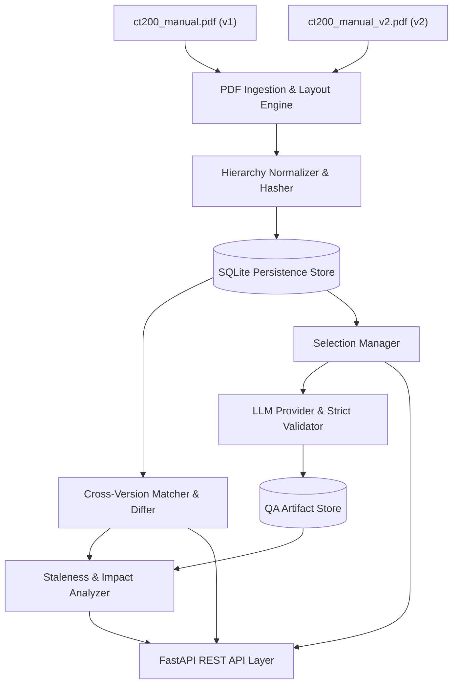
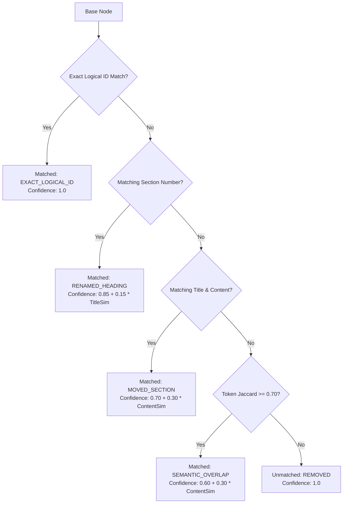

# Architecture & Design Decisions — Tri9T Manual Intelligence Platform

## 1. System Overview

The **Tri9T Manual Intelligence Platform** is an enterprise-grade document intelligence system designed to ingest, normalize, version-diff, test-generate, and audit complex technical documentation (such as medical device operator manuals).

---

## 2. Core Technology Choices & Trade-Offs

### 2.1 Backend Framework: FastAPI & Pydantic v2
- **Rationale**: FastAPI provides high-throughput async/sync request execution, native OpenAPI documentation generation, and seamless integration with Pydantic v2.
- **Trade-off**: Requires strict typing discipline across all schemas. Pydantic v2 provides a 5–10x speedup in parsing and validation compared to v1, ensuring sub-millisecond response times for large document payloads.

### 2.2 Persistence: SQLAlchemy with SQLite
- **Rationale**: SQLite is a self-contained, zero-configuration relational database engine ideal for portfolio auditability and local deterministic evaluation without external database servers. Using SQLAlchemy provides an ORM abstraction with indexed tables, relational foreign keys, cascade deletes, and clean session scoping.
- **Trade-off**: SQLite handles concurrent reads exceptionally well, but serializes writes. For high-concurrency production deployments, switching the database driver to PostgreSQL requires only updating the `DATABASE_URL` environment variable.

### 2.3 PDF Parsing: PyMuPDF + pdfplumber Dual Engine
- **Rationale**: 
  - **PyMuPDF (fitz)**: Ultra-fast C-native text, font-size, font-flag (boldness), and bounding box extraction. Essential for font-size-based heading hierarchy detection and reading-order reconstruction.
  - **pdfplumber**: Best-in-class tabular grid line detection, header recovery, and multi-line cell text extraction.
- **Trade-off**: PyMuPDF can be sensitive to custom font CMaps and Unicode ligatures (such as `\ufb01` for `fi`). We mitigate this by applying Unicode NFKD normalization across all extracted text blocks before downstream processing.

---

## 3. Node Identity Strategy

A central challenge in versioned document management is defining how a section is identified across revisions.

> [!IMPORTANT]
> **Why Section Titles Alone Cannot Be Identifiers:**
> 1. Duplicate titles exist within the same document under different parents (e.g. `4.2 Error Codes` under *Alarms and Safety Behavior* vs `7.1 Error Codes` under *Troubleshooting*).
> 2. Titles can be rephrased or corrected across versions (e.g., fixing a typo or clarifying a phrase).
> 3. Database primary keys change per revision snapshot.

### The Tri9T Solution: Three-Layer Identity Architecture
1. **`node_id` (Version-Scoped Physical Primary Key)**:
   - Format: `{version}_{logical_id_slug}` (e.g. `v1_sec_4_2_error-codes`).
   - Uniquely identifies the immutable physical record of that section in that specific document version.
2. **`logical_id` (Cross-Version Stable Anchor)**:
   - Format: `sec:{section_number}:{slugified_title}` (e.g. `sec:4.2:error-codes`).
   - Represents the logical conceptual entity across document revisions.
   - For unnumbered subheadings, anchored under parent: `{parent_logical_id}:sub:{title_slug}`.
3. **`content_hash` (Deterministic Cryptographic Digest)**:
   - SHA-256 computed over Unicode-normalized section number, title, body paragraphs, and canonical table JSON.
   - Any character or numerical change alters the hash, triggering change detection while preserving logical identity.

---

## 4. Cross-Version Matching Algorithm

When comparing v1 to v2, matching logically equivalent nodes is executed in three cascading phases:

### Ambiguity Flagging
If multiple target candidates match a base node with a confidence difference of less than 0.10, `is_ambiguous = True` is flagged in the response, preventing false-positive automatic merges.

---

## 5. LLM Provider & Bounded Validation Engine

To eliminate external dependencies, flaky network calls, and paid API requirements during evaluation, the platform implements a pluggable provider abstraction:

- **`BaseLLMProvider`**: Common abstract interface with `generate(prompt, system_prompt)` and `get_provider_info()`.
- **`MockLLMProvider`**: Deterministic rule-based synthesizer that analyzes the prompt context, extracts numerical thresholds, safety assertions, and error conditions, and synthesizes 3 to 5 realistic QA test ideas grounded in the source text.
- **`LiveHTTPLLMProvider`**: Standard OpenAI / Gemini REST endpoint caller via `httpx`, which automatically falls back to `MockLLMProvider` if credentials are not configured.
- **`QAOutputValidator`**:
  - Enforces Pydantic schema validation (`test_id`, `test_objective`, `preconditions`, `steps`, `expected_result`, `source_references`).
  - Enforces the 3-to-5 test count constraint.
  - Executes bounded retries (up to 2 retries) with corrective feedback prompts explaining the validation violation.
  - Rejects malformed JSON and provider errors with structured error responses, never presenting ungrounded or invalid test cases as valid.

---

## 6. Staleness & Impact Analysis Methodology

When a manual is updated from v1 to v2, existing QA test artifacts pinned to v1 may become stale. The platform distinguishes between harmless editorial changes and critical safety parameter modifications:

### Severity Classification Engine
1. **`HIGH` Severity**:
   - Numerical values changed (e.g. overpressure deflation time reduced from 2.0s to 1.5s, or battery life reduced from 300 to 250 cycles).
   - Error codes added or modified (e.g. E6 added for Bluetooth sync failure).
   - Safety conditions, warnings, or contraindications altered.
   - Node completely removed in the target version.
2. **`MEDIUM` Severity**:
   - Substantial procedural or explanatory wording modified (token Jaccard similarity < 0.80) without changing numbers.
   - Node relocated to a completely different parent section.
3. **`LOW` Severity**:
   - Minor editorial phrasing, punctuation, or formatting changes.
   - Node section number shifted while content remains byte-identical.
